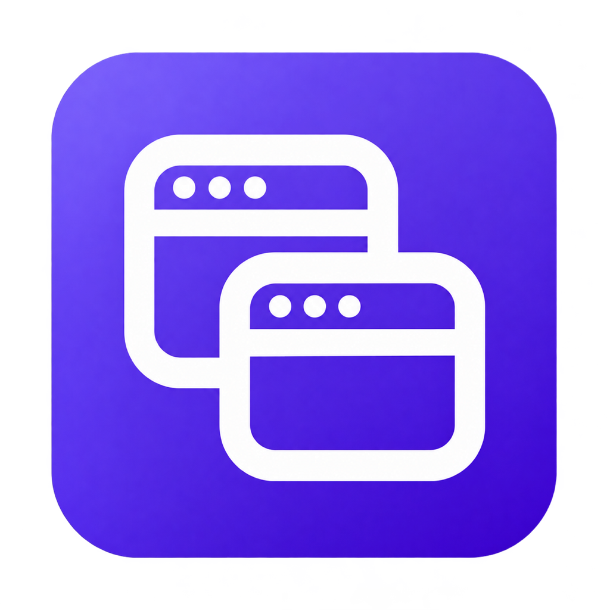
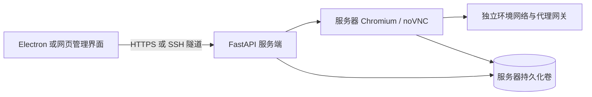

<p align="center"></p>

# Browser Workspace

自托管的浏览器环境管理工具：**Electron 桌面客户端 + FastAPI 服务端 + Docker 中的远程 Chromium**。支持独立环境、代理、团队权限、标签备注和 2FA 验证码。

目标网站的 Cookie、浏览器环境文件、代理凭据和 2FA 密钥保存在服务器。Electron 负责管理和远程操作；桌面端的管理登录会话使用内存分区，关闭应用后需重新登录。网页管理端会保存管理登录 Cookie。

这是一个早期原型，指纹能力取决于所选内核；不保证网站不会关联账号。当前使用共享容器和 `--no-sandbox`，适合可信团队试用，完整边界见[功能与限制](docs/FEATURES.md)。

## 文档入口

| 想做什么 | 从这里开始 |
| --- | --- |
| 部署到 Linux 服务器、配置 HTTPS、更新和备份 | [部署指南](docs/DEPLOYMENT.md) |
| 本地启动 Electron、打包 macOS / Windows / Linux | [桌面打包指南](docs/PACKAGING.md) |
| 用 Codex 操作本地项目或通过 SSH 部署 | [Codex 部署指南](docs/CODEX.md) |
| 查看团队、代理、内核、2FA 的使用方式和限制 | [功能说明](docs/FEATURES.md) |
| 查看部署脚本和配置项 | [deploy.sh](deploy.sh) · [.env.example](.env.example) |

## 快速部署服务端

在 Linux 服务器上准备 Git、Bash、OpenSSL、Docker Engine 和 Docker Compose v2，当前用户需要能操作 Docker。macOS 本地预览使用 Docker Desktop。安装步骤见[部署指南](docs/DEPLOYMENT.md)。

```bash
git clone https://github.com/evte/browser-workspace.git
cd browser-workspace
./deploy.sh up
```

脚本首次创建权限为 `600` 的 `.env`，生成随机初始管理密码，然后构建镜像、启动服务并等待健康检查。重复运行保留已有配置和数据卷。脚本不安装 Docker；缺少依赖或服务启动失败会返回非零状态。

默认只监听服务器 `127.0.0.1:8000`。在**自己的电脑**建立 SSH 隧道，并保持该终端打开：

```bash
ssh -N -L 8000:127.0.0.1:8000 用户名@服务器地址
```

打开 <http://127.0.0.1:8000>，或在 Electron 中填写这个地址。首次注册时，在**服务器终端**执行以下命令查看初始管理密码：

```bash
./deploy.sh password
```

用该密码完成首个账号注册，之后使用注册邮箱和账号密码登录。它不是通用默认密码，也不是之后的账号登录密码。多人远程访问请配置有效证书的 HTTPS，示例见[部署指南](docs/DEPLOYMENT.md)。

## 常用维护命令

在服务器项目目录执行：

```bash
./deploy.sh status   # 查看容器状态
./deploy.sh logs     # 查看日志
./deploy.sh update   # 干净工作区中拉取当前分支并重新构建、启动
./deploy.sh stop     # 停止服务，保留数据卷
./deploy.sh up       # 构建并启动当前代码
./deploy.sh help     # 参数和说明
```

更新、停止或重新创建容器会中断运行中的浏览器。更新前按[部署指南](docs/DEPLOYMENT.md)备份数据卷和 `.env`。不要使用 `docker compose down -v`；它会删除环境、账号和 Cookie。已有部署应复用原来的 Compose 项目名，避免连接到一个新的空卷。

## 本地启动和打包桌面客户端

在有图形桌面的电脑上安装 **Node.js 22.12+**，克隆本仓库后执行：

```bash
npm ci
npm start
```

连接已部署的服务端。桌面端不包含后台服务器，也不会在本地保存目标网站的浏览器环境。

在目标操作系统和架构上打包：

```bash
npm run test:desktop
npm run pack
```

产物位于 `dist/Browser Workspace-<平台>-<架构>/`，例如 macOS Apple Silicon 的 `Browser Workspace-darwin-arm64/Browser Workspace.app`。目前生成应用目录，未提供 DMG / Windows 安装器 / AppImage、开发者证书签名、公证或自动更新。平台路径、图标更新、分发与故障排查见[打包指南](docs/PACKAGING.md)。

## 用 Codex 部署

可在 Codex 桌面端打开本地仓库，让它通过你已配置的 SSH 部署；也可以在服务器上运行 Codex CLI。项目提供 [AGENTS.md](AGENTS.md)，说明源码结构、测试命令和数据保留要求。

把下面的提示词交给 Codex，并替换 SSH 别名与部署目录：

```text
读取 AGENTS.md、README.md 和 docs/DEPLOYMENT.md。
通过我已配置的 SSH 别名 browser-prod，把这个仓库部署到 ~/apps/browser-workspace。
检查目标系统、Docker Compose、端口、磁盘和已有部署，使用 deploy.sh。
已有配置、数据卷和 2FA 主密钥必须保留，复用原项目名。
使用 SSH 隧道访问，完成后核对容器状态和 /api/session，给出访问方式和实际验证结果。
不要输出密钥或管理密码；只告诉我在服务器上查看密码的命令。
```

安装、登录、无浏览器服务器的设备码登录，以及云端 Codex 的使用方式见[完整 Codex 指南](docs/CODEX.md)。本项目运行不依赖 Codex 或 OpenAI API。

## 项目结构

```text
backend/       FastAPI、账号团队、代理、内核和浏览器进程管理
frontend/      网页管理界面（原生 JavaScript / HTML / CSS）
desktop/       Electron 客户端、连接页、权限限制和图标
tests/         服务端与部署脚本测试
docs/          部署、打包、Codex 和功能文档
deploy.sh      服务端部署与维护入口
compose.yaml   容器、网络能力和持久化卷配置
```



## 开发与验证

桌面和部署脚本测试：

```bash
npm run test:desktop
python3 -m unittest discover -s tests -p 'test_deploy.py' -v
```

完整后端测试使用独立 Python 环境，安装 `backend/requirements.txt` 和 `httpx` 后执行：

```bash
PYTHONPATH=. python -m unittest discover -s tests -v
```

网络命名空间集成测试需要有相应能力的 Linux 容器。项目尚未建立自动发布流程；仓库公开不代表已经发布安装包。现阶段未指定开源许可证，第三方组件沿用各自许可证。
